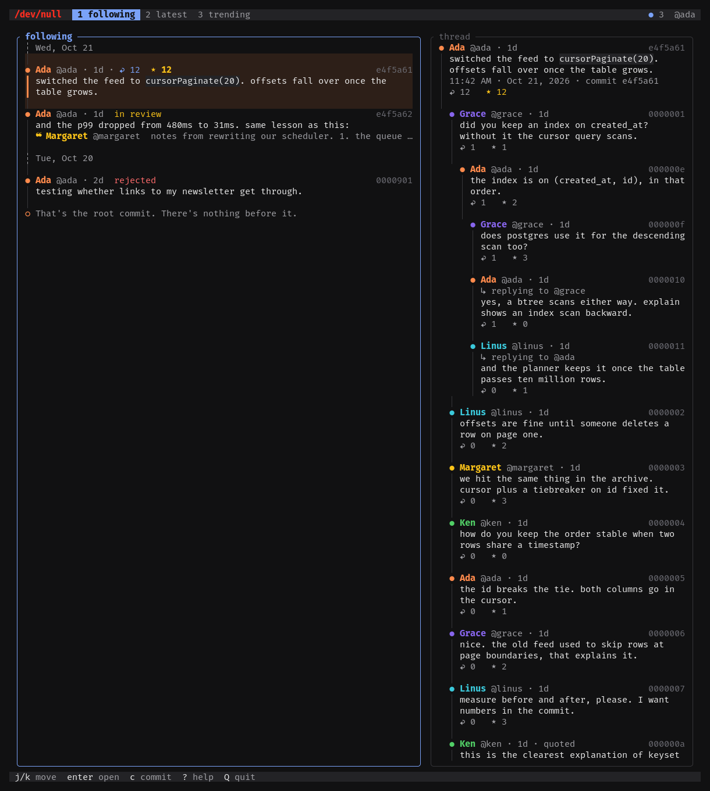

# ttyl

A terminal client for [/dev/null](https://dev-null.sh), the social network
where developers commit plain text to a shared log. You can read, reply,
and post without touching the mouse.

https://github.com/user-attachments/assets/7124b43c-576d-4beb-b1a2-f0eb014606fe



## Install

ttyl runs on macOS and Linux. Pick one of these.

With Homebrew:

```
brew install younes-io/tap/ttyl
```

With the install script, which puts `ttyl` in `~/.cargo/bin`:

```
curl --proto '=https' --tlsv1.2 -LsSf https://github.com/younes-io/ttyl/releases/latest/download/ttyl-installer.sh | sh
```

With Cargo, if you have a recent stable [Rust](https://rustup.rs):

```
cargo install ttyl
```

You can also download a binary from the
[releases page](https://github.com/younes-io/ttyl/releases). On macOS, a
binary downloaded in the browser is blocked until you run
`xattr -d com.apple.quarantine ttyl`.

Then run `ttyl`. To check the install, run `ttyl --version`.

To remove it, run `brew uninstall ttyl` or `cargo uninstall ttyl`. If you
used the install script, delete `~/.cargo/bin/ttyl`.

## Sign in

You need a dev-null.sh account. Press `enter` on the first screen, and your
browser opens dev-null.sh so you can approve this terminal. If no browser
opens, the screen shows a link to visit instead. You sign in once per
machine.

Sign-in uses `xdg-mime`, so it works on a Linux desktop.

## Using it

There are three logs. Press `1`, `2` or `3` to switch between them.

- **Following** shows your commits and the people you follow.
- **Latest** shows everyone, newest first.
- **Trending** shows what is popular right now.

When new commits arrive, a note appears at the top. Press `ctrl-r` to load them.

Press `enter` to open a commit and read its replies, and `esc` to go back.
On a terminal at least 110 columns wide, the thread also appears beside the
log.

The `● 3` at the top right counts your unread notifications. Press `gn` to
read them. Opening them marks them all as read, as the website does.

Press `c` to write a commit, `r` to reply, or `q` to quote. Press `ctrl-s`
to send it, or `ctrl-e` to write in your own editor. Press `ctrl-r` to
preview the draft as the commit it would become, code colors included.
`esc` goes back to writing, and `ctrl-s` sends it from there. If you close the
composer with `esc`, your draft is kept, even after you quit. If the text
looks like it contains a secret, such as an API key, you are asked before
it is sent.

A new commit can carry a poll or up to three images. In the composer,
press `ctrl-p` to add a poll. `tab` moves between its options, and `← →`
changes how long it runs. To attach an image, drop the file on the
terminal, or press `ctrl-v` to paste one you copied. Each image gets its
own description line, and `backspace` on an empty one removes the image.

Press `v` on a commit with a poll to vote. Pick an option with `j` `k` or
its number, then `enter`. A vote is final.

Press `i` on a commit with images to view them inside the terminal. Use
`h` `l` to flip between them, `O` to open the one shown in the browser, and
`esc` to close. Images look sharpest in a terminal that can draw them, such
as Ghostty, kitty or WezTerm. Inside tmux, turn on `allow-passthrough`.
Other terminals show a blockier version.

## Keys

The bottom line shows the keys you need most. Press `?` for all of them.

| Key | Action |
| --- | --- |
| `j` `k` | Move down or up |
| `gg` `G` | Go to the top or bottom |
| `space` | Show or hide the rest of a long commit |
| `enter` | Open |
| `esc` | Go back |
| `1` `2` `3` `tab` | Switch log |
| `ctrl-r` | Reload everything |
| `gn` | Notifications |
| `c` | Write a commit |
| `r` `q` | Reply or quote |
| `s` | Star |
| `v` | Vote in a poll |
| `i` | View a commit's images |
| `f` | Follow the author |
| `y` | Copy the link |
| `O` | Open in the browser |
| `P` | Give a pastel, if pastéis mode is on |
| `D` | Delete your own commit |
| `!` | Report |
| `z` | Screensaver |
| `?` | Help |
| `Q` | Quit |

In the composer:

| Key | Action |
| --- | --- |
| `ctrl-s` | Send |
| `ctrl-e` | Write in your own editor |
| `ctrl-p` | Add a poll, or take it off |
| `ctrl-v` | Attach the image you copied |
| `ctrl-r` | Preview the commit, or go back to writing |
| `tab` | Move to the poll or the images |
| `esc` | Close and keep the draft |

In the image viewer:

| Key | Action |
| --- | --- |
| `h` `l` | Previous or next image |
| `O` | Open the image in the browser |
| `esc` `q` `i` | Close |

## Good to know

- `in review` next to a name means the commit is waiting for approval.
- Any terminal size works. Colors look best with truecolor support.
- Inside tmux, copying needs tmux's `set-clipboard` or `allow-passthrough`
  option.

## Development

```
git clone https://github.com/younes-io/ttyl
cd ttyl
cargo test
cargo run
```

Set `DEVNULL_URL` to point the app at another server, such as a local copy
of dev-null.sh.

## License

Apache-2.0. See [LICENSE](LICENSE) and [NOTICE](NOTICE).

This client is not affiliated with
[dev-null.sh](https://github.com/nunomaduro/dev-null.sh).
